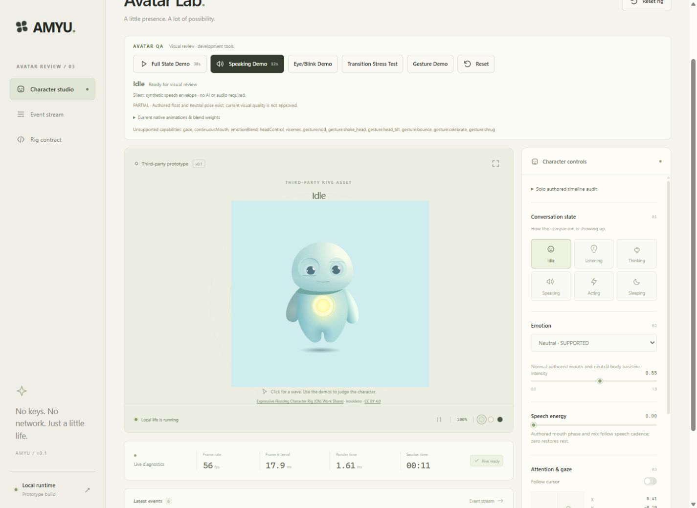
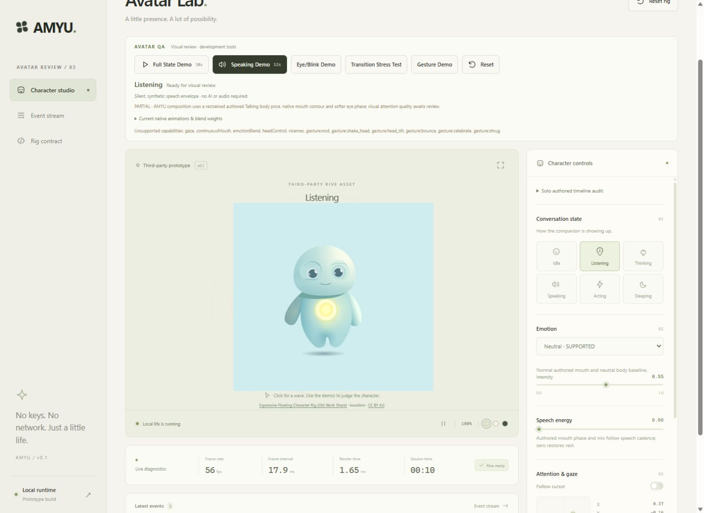
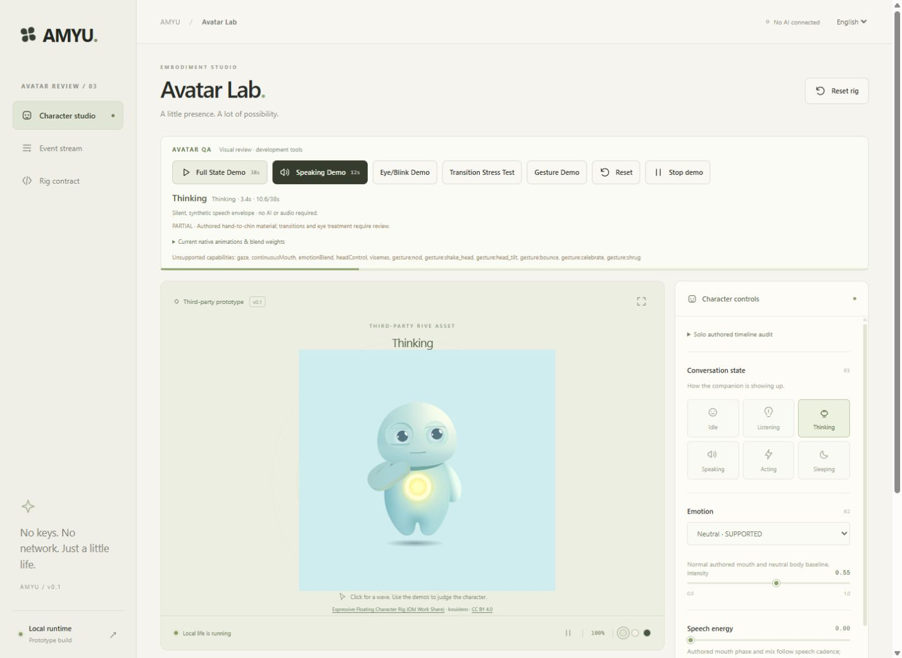
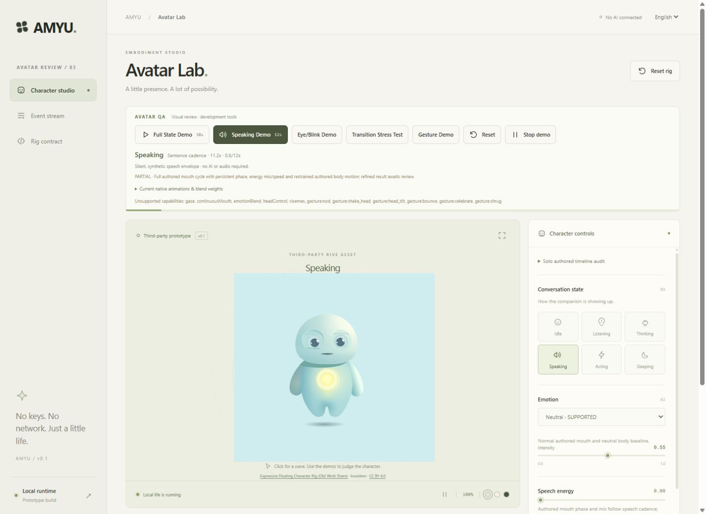
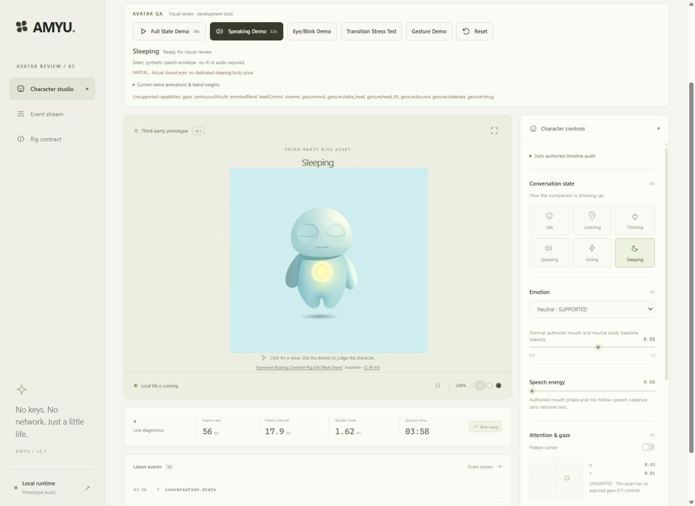
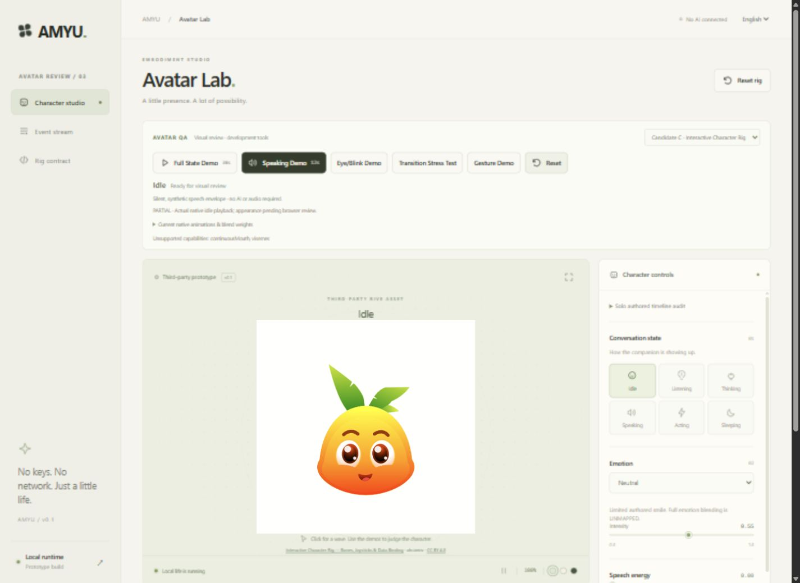

# Candidate A deep refinement and Candidate C evaluation — historical record

This preserves the completed A/C review before the Friendly Floating Bot work. For the active prototype, latest validation and recommendation, use [the current product review](avatar-deep-review.md). Statements about the default candidate below describe that earlier review stage.

Updated **2026-10-05**. **The requested six-state visual quality is not achieved, and no avatar is approved.** This report supersedes the earlier correction's favorable agent impressions. It records the completed refinement of Candidate A and actual evaluation of Candidate C. Following the user's rejection of C, a search for a softer robot closer to A's style is underway.

## A. Active avatar

**Candidate A — Expressive Floating Character Rig (Old Work Share), by kouidero** remains the default unapproved reference. Its original file is unchanged: 66,484 bytes, SHA-256 `cdef4cf409850321d28e31e5cd8c4e12ee27072f1da609e4b3c216e709cc3f62`, CC BY 4.0. The generated developer character remains a test fixture only. Candidate C was restored to comparison-only status after the user explicitly rejected its model.

## B. What changed visually

A complete audit of all eighteen actual timelines preceded one focused refinement pass. The eyes use a softer authored lid phase, faster closure, slower reopening, varied blink timing and occasional double blinks. The rejected held-wave listening pose was removed. Thinking keeps the authored hand-to-chin with subtle deterministic variation. Speaking plays the full mouth cycle with a persistent clock, variable speed and irregular syllable cadence; restrained authored body movement accompanies it. Restoring authored start poses and normal-mouth geometry addresses retained hands and mouth.

These changes improve execution, but do not make listening, speech, facial expression or attention convincing enough for the brief. See the [complete animation audit](avatar-animation-audit.md) and [six-state specification](avatar-state-design.md).

## C. Idle

**PARTIAL.** The rounded mint character floats gently and blinks with varied timing. Actual idle was observed for **3m25s**, with the displayed clock advancing from 4:37 to 8:02 after the stress run. The fixed five-second float repeats conspicuously, and fixed pupils still feel like staring. Local life controls blink timing, but many posture and gaze fields have no artwork mapping. This was real browser observation, separate from deterministic simulation tests.

## D. Listening

**FAIL.** The revised authored body still pose and small mouth curl remain almost indistinguishable from idle. Slightly more open eyes do not provide a readable attentive posture. The stress sequence executed ten idle ↔ listening pairs; direct comparison failed the label-free recognition goal. The native `Listening` timeline affects only five mouth drawing commands, not head, body or eyes. Holding a wave was rejected and removed.

## E. Thinking

**PASS for recognizable thought and the sampled transitions.** The genuine authored hand-to-chin is clearly visible. Its phase varies gently from 0.91 to 0.99 rather than freezing completely. The hand releases on thinking → speaking and thinking → idle, with no observed latch in sampled transitions or the final stress pose. Fixed pupils still limit inward attention. This is an agent observation, not human approval.

## F. Speaking

**PARTIAL.** The twelve-second demo completed with uneven syllable bursts, micro pauses, phrase pauses and stronger/weaker emphasis. The mouth changes and the body moves. At normal stage size the mouth remains too small and the body cue too subtle to clearly communicate speech. The demo ends in idle with zero speech energy and a normal mouth.

## G. Exactly how the mouth is animated

The file has no verified numeric mouth-open input, speech-energy input or visemes. AMYU uses the actual `Mouth-talk` **0.5–1s authored work range**. Solo phases show closed line → slit → triangle → slit → line. Its clock continues during pauses and while inactive, so an energy change does not restart it. Mix equals bounded speech energy; playback speed is **0.7 + 0.65 × energy**. At zero energy, authored start-pose paint and `Mouth-normal` geometry restore rest. Smile weight decreases as speech energy rises.

`Talking` supplies restrained body motion: speaking weight × **(0.12 + 0.38 × energy)** and speed **0.65 + 0.2 × energy**. The twelve-second synthetic envelope has 28 irregular syllable pulses. The Full State Demo uses ten seconds of this cadence. This is authored timeline playback and mixing, not a continuous mouth rig or phoneme lip sync.

## H. Eyes

All eight eye timelines were reviewed individually. The bilateral route uses `EYES-open`: progress 0 is closed; semantic openness is scaled by 0.72 to soften the formerly wide endpoint. Idle/listening/thinking/speaking/acting target openness is 0.84/0.93/0.74/0.87/0.91 before scaling and local variation; sleeping converges fully to zero.

Local blinks vary around **210–290ms**, with fast closure, a short hold and slower reopening. Timing varies and occasional double blinks are included. The twenty-second Eye/Blink Demo completed; sampled frames showed closure and reopening without an obvious geometry explosion. Unilateral wink and lower-left eyelid routes were rejected as the natural bilateral blink. **Blink execution passes; overall eye quality remains partial** because fixed pupils and limited facial channels cannot create directed attention. No eye tracking is claimed.

## I. States still weak

Listening fails the recognition goal. Speaking and mouth are partial. Idle remains repetitive. Sleeping closes the eyes but retains the normal body float. **Acting has no distinct authored representation and is unsupported.** Wake reopens the eyes and returns cleanly. Six semantic state buttons do not mean this artwork visibly performs all six.

## J. All ten emotions

All ten were sampled in the browser at normal intensity. The classification describes distinct visible representation, not the presence of a semantic number.

| Emotion | Classification | Actual result |
| --- | --- | --- |
| Neutral | SUPPORTED | Normal mouth and neutral authored body |
| Happy | PARTIAL | Small authored smile; limited whole-face expression |
| Excited | UNSUPPORTED | A stronger shared smile does not establish excitement |
| Curious | UNSUPPORTED | No distinct curious face or mapped head/gaze cue |
| Concerned | UNSUPPORTED | No mapped brow/frown channels |
| Surprised | UNSUPPORTED | No distinct surprise face |
| Empathetic | UNSUPPORTED | A gentle shared smile is not a distinct expression |
| Amused | UNSUPPORTED | No distinct amused face or squint |
| Focused | UNSUPPORTED | No distinct focus expression |
| Confused | UNSUPPORTED | No mapped tilt/frown expression |

## K. Gestures and interactions

**Wave is the only genuinely supported gesture.** The 20.4s Gesture Demo completed with wave from idle, listening, thinking and speaking, including completion/interruption and return to rest. Rendered samples show the arm rise, replace the thinking hand pose, and return to neutral. Nod, shake-head, head-tilt, bounce, celebrate and shrug remain unsupported.

Clicks request only supported gestures and repeated requests coalesce. Hover has only a limited smile component, with no gaze or head-follow mapping. Final direct hover/click browser findings remain to be recorded; no interaction quality pass is claimed from bounded-value tests alone.

## L. Candidate A practical ceiling

**Can this asset reach the required quality? NO.** More than the specified two areas remain poor:

| Area | Finding |
| --- | --- |
| Eyes | Softer and functional, but fixed pupils still limit life |
| Listening | FAIL: too similar to idle |
| Speaking | PARTIAL: mouth/body too subtle |
| Mouth | PARTIAL: full cycle exists, weak stage articulation |
| Facial expressiveness | One small smile, no broad distinct face control |
| Attention/gaze | Directed pupil/head control unsupported |

A beauty refinement stopped at this decision. Further timeline tuning cannot supply missing independent facial controls or a purposeful acting pose.

## M. Actual Candidate C evaluation

[Interactive Character Rig — Bones, Joysticks and Data Binding](https://rive.app/marketplace/28370-53642-interactive-character-rig-bones-joysticks-and-data-binding/) by **aln.omrv** was downloaded unchanged on **2026-10-04** from the [official runtime export](https://public.rive.app/community/runtime-files/28370-53642-interactive-character-rig-bones-joysticks-and-data-binding.riv). The official page links to [CC BY 4.0](https://creativecommons.org/licenses/by/4.0/). Its size is **12,722 bytes**, SHA-256 `82b2160f32b7226f60db9d812cc8d33162382cd80c80ac3088b530acf3d58335`.

Actual Rive 2.44 inspection finds `Carrot main` / `State Machine 1`, **zero state-machine inputs**, twelve timelines and only `ViewModel1.Instance.triggerProperty`. No numeric, boolean or nested properties are exported. Binding and firing that trigger produces genuine idle → active → idle motion.

**Actual browser appearance:** a bright orange/yellow floating carrot head with green leaves, large glossy eyes, a happy open mouth and a white baked background. Clicking plays an authored active reaction: the head and pupils turn up-left with a brow tilt, then return to idle. This is real movement, but it does not establish independent head/pupil controls or a speech mouth route.

Named head/pupil/brow/eyelid timelines produced no phase-varying vector effects in seven-phase probes with fresh, Source, Timeline 1 and idle baselines. Ordinary pointer movement did not change same-time idle geometry. A missing WebGL/image-mesh warning limits those headless probes. Authored-handle dragging was not fully established before the user rejected the model; no stronger negative claim is made.

**The user explicitly rejected C's model.** C beauty work and further selection evaluation stopped. It is not an approved replacement, regardless of its authored reaction. See [C technical evidence](interactive-character-capabilities.md), [inspection JSON](interactive-character-inspection.json) and [phase/binding audit](interactive-character-animation-audit.json).

## N. A versus C and active selection

**Do not switch the active prototype to C.** The user rejected its look. A is retained as the unapproved style/reference baseline while the newly requested search looks for an existing soft robot asset.

| Criterion | Candidate A | Candidate C | Conclusion |
| --- | --- | --- | --- |
| Visual appeal | Soft rounded mint figure, closer to requested style | Bright carrot head; explicitly rejected | C rejected by user |
| Eyes | Softer lids; fixed pupils | Large glossy eyes, authored directional reaction | C appearance not accepted |
| Blink | Actual bilateral closure/reopening | Named clips exist; independent phase route unverified | A has verified current blink |
| Listening | FAIL, almost idle | No verified distinct listening pose | Neither meets target |
| Thinking | Recognizable hand-to-chin | No verified thought pose | A has useful actual material |
| Speaking | PARTIAL, small mouth/body changes | No speech input or talking clip found | C does not solve verified speech |
| Mouth | Full authored cycle, small on stage | Happy open mouth; no verified speech route | Neither meets target |
| Gaze | Unsupported | Pupils move in generic activation; no numeric axes | No verified independent C gaze |
| Head movement | Authored poses, no head follow | Actual active reaction turns head | Authored movement, not head following |
| Facial expression | Neutral and partial smile | Happy base and authored brow tilt | C independent face rig unverified |
| Gestures | Wave only | Generic native activation | C does not supply seven gestures |
| Idle life | Repetitive 5s float; varied local blink | Original 2s idle, no sustained acceptance review | C review stopped on rejection |
| Runtime controllability | 18 timelines; two diagnostic booleans; authored-only playback | 12 timelines; zero inputs; one bound VM trigger | Both have limited measured controls |
| Integration complexity | Existing adapter and canonical resets | Native VM binding and pointer events | No simple exposed numeric face API in C |
| License | Attributed unchanged CC BY 4.0 | Attributed unchanged CC BY 4.0 | Both verified |
| Long-term usefulness | Practical face/attention ceiling reached | Rejected appearance, speech route absent | Neither is an approved six-state solution |

## O. Actual review evidence

Environment: Windows, Codex in-app browser, local `http://127.0.0.1:5173/`, Rive Canvas **2.44.0**. Review used the actual rendered canvas, not telemetry as proof of appearance. No recording was produced; development demos are repeatable.

| Review | Execution and result |
| --- | --- |
| Complete A audit | All 18 timelines solo before the focused pass, including eight eye variants and full mouth phase range |
| Full State Demo | **38s completed**: idle4/listening5/thinking5/speaking10/acting4/sleeping5/wake2/idle3; states also reviewed individually |
| Speaking Demo | **12s completed**; samples show changing mouth/body, pauses and neutral completion |
| Eye/Blink Demo | **20s completed**; closure/reopening and sampled double-blink phase; overall eye appeal partial |
| Idle observation | **3m25s actual browser idle**; repetitive float and fixed gaze remain |
| Transition Stress | **113s completed**: nine initial edges, ten idle/listening pairs, rapid L/T/S every 500ms, ten speaking/idle, thinking/idle and wave/idle pairs |
| Stress observation limit | All nine initial transitions captured; final neutral checked; middle repeated phases executed but not continuously watched frame by frame |
| Gesture Demo | **20.4s completed**; Wave from four states, interruption and neutral return |
| Ten emotions | All sampled at normal intensity; baseline plus small shared smile |
| Candidate C | Original rendered appearance and real native click activation observed; user rejected model |
| Hover/click A | Final direct rendered interaction findings pending |

The stress samples and final pose showed no stuck hand, mouth or eye shape, no retained body pose and no observed draw-order failure. This bounded observation is not a guarantee against every possible combination.

### Captures

These are actual browser captures, not mockups. State screenshots are from the refined A pass; a still frame cannot establish animation timing.

| Idle | Listening |
| --- | --- |
|  |  |

| Thinking | Speaking |
| --- | --- |
|  |  |

| Sleeping | Candidate C, rejected |
| --- | --- |
|  |  |

Additional evidence: [idle after 3m25s observation](screenshots/avatar-deep-refinement/idle-long-observation.jpg), [completed stress neutral return](screenshots/avatar-deep-refinement/stress-idle-return.jpg), [C authored active reaction](screenshots/avatar-deep-refinement/candidate-c-active.jpg). Detailed edge captures remain in `outputs/avatar-deep-refinement/screenshots`.

### Visual acceptance matrix — Candidate A

PASS means the recorded rendered criterion passed; PARTIAL means execution exists with a material quality limit; FAIL means observed behavior misses the criterion; UNSUPPORTED means no defensible visible mapping. None grants human approval.

| Feature | Result | Visual quality | Native/Composed | Limitation |
| --- | --- | --- | --- | --- |
| Idle | PARTIAL | Calm float, repetitive over 3m25s | Authored 5s idle + local blink | Fixed gaze, limited posture variation |
| Eyes | PARTIAL | Softer lids, still a fixed stare | Authored bilateral phase | No pupil control |
| Blink | PASS | Quick closure and softer reopening | Authored lids + local timing | Eye appeal is separate |
| Listening | FAIL | Almost identical to idle | Talking still + mouth contour + lid openness | No readable attentive pose |
| Thinking | PASS | Clear hand-to-chin | Authored Thinking + slight variation | No directed inward gaze |
| Speaking | PARTIAL | Real but small mouth/body movement | Mouth-talk + Talking + cadence | Weak label-free readability |
| Mouth | PARTIAL | Closed/slit/triangle cycle and normal return | Full authored work range | Small artwork; no aperture input/visemes |
| Acting | UNSUPPORTED | No distinct purposeful action | Semantic state only | No suitable authored mapping |
| Sleeping | PARTIAL | Clearly closed eyes | Authored lid closure | Body still floats normally |
| Wake | PASS | Eyes reopen; neutral return | Awake/state interpolation | No dedicated wake-body clip |
| Hover | PARTIAL | Limited smile component | Mouth-smile | Direct final review pending; no gaze/head follow |
| Click | PARTIAL | Coalesced authored wave request | Waving | Direct final repeated-click review pending |
| Wave | PASS | Actual arm wave and return | Authored Waving | Only supported gesture |
| Other gestures | UNSUPPORTED | Six absent behaviors explicit | No mapping | Nod/shake/tilt/bounce/celebrate/shrug absent |
| Happy | PARTIAL | Small smile | Authored Mouth-smile | Limited whole-face meaning |
| Curious | UNSUPPORTED | No distinct face | Unmapped semantic intent | No curiosity controls |
| Concerned | UNSUPPORTED | No distinct face | Unmapped semantic intent | No frown/brow controls |
| Surprised | UNSUPPORTED | No distinct face | Unmapped semantic intent | No surprise controls |
| Gaze | UNSUPPORTED | No pupil following | Telemetry only | No visible mapping |
| Head follow | UNSUPPORTED | No head following | Telemetry only | No visible mapping |
| Return-to-idle | PASS | Hands, eyes and mouth neutral | Start-pose/paint/geometry restoration | Sampled edges and final complete stress pose |

## P. Automated validation

The final deep-pass `pnpm check` result remains pending the completed review integration. It includes lint, TypeScript, meaningful regression tests and both frontend production builds. The prior **84 tests / 12 files** result belongs to the previous correction and is not reused as proof of this pass.

New coverage includes persistent authored clocks, neutral restoration, speech cadence and demo cancellation, deterministic eye timing, sleep closure and supported-only gesture behavior. These checks do not override visual failures. Native executable validation remains outside this milestone; historical Windows Application Control error **4551** is unchanged.

## Q. Recommendation and next gate

**FREE ASSETS ARE INSUFFICIENT — for the evaluated A/B/C set against this brief.** This is not a claim about every free asset. A reached its facial/state ceiling; previously evaluated B had no mouth/talking route; C does not supply a verified six-state solution and the user rejected its look.

The user's latest direction authorizes searching for another existing asset with a soft appearance closer to A, preferably a robot. That search is a continuation of avatar selection, not approval of A or C. Any new candidate must be judged by its actual rendered appearance and verified controls before replacement. No homemade artwork is authorized.

Onboarding and all other product work remain paused until explicit human visual approval. The final new-candidate outcome and current validation result must be recorded before presenting the overall milestone as complete.

