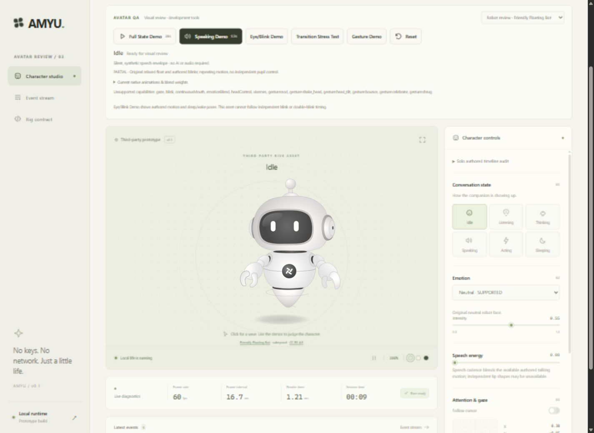
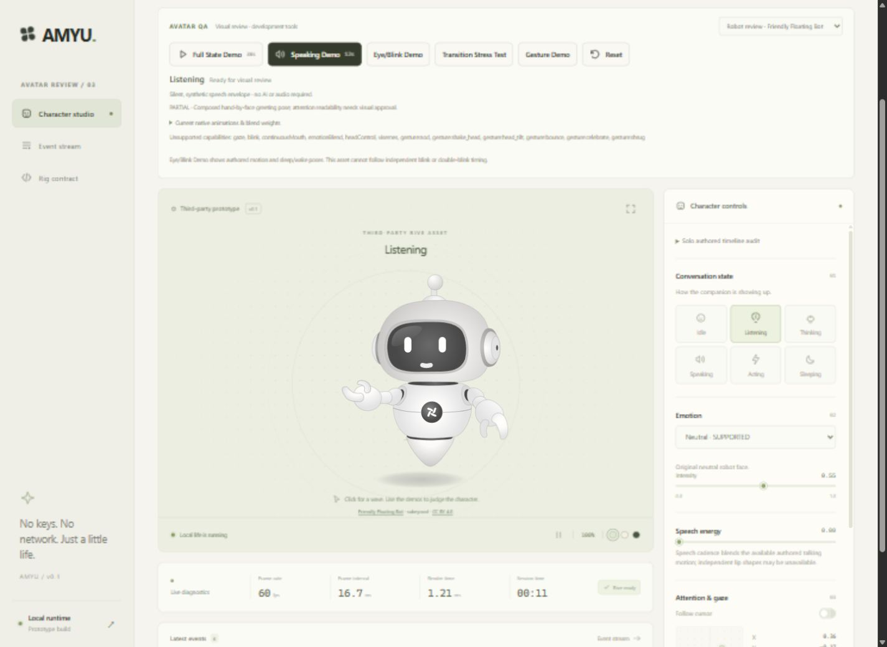
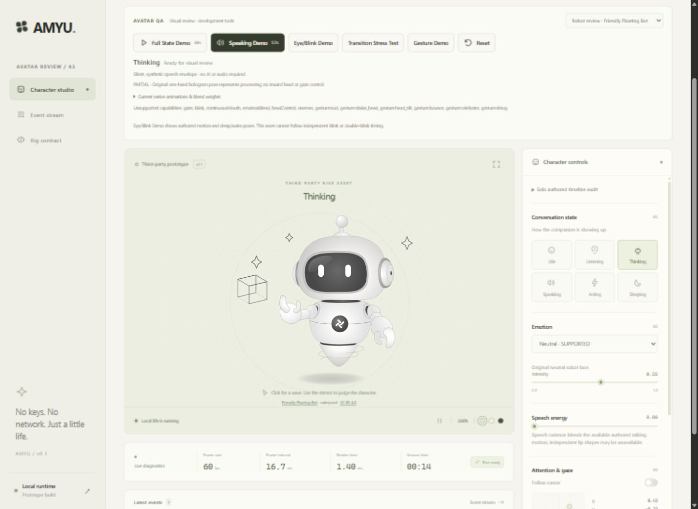
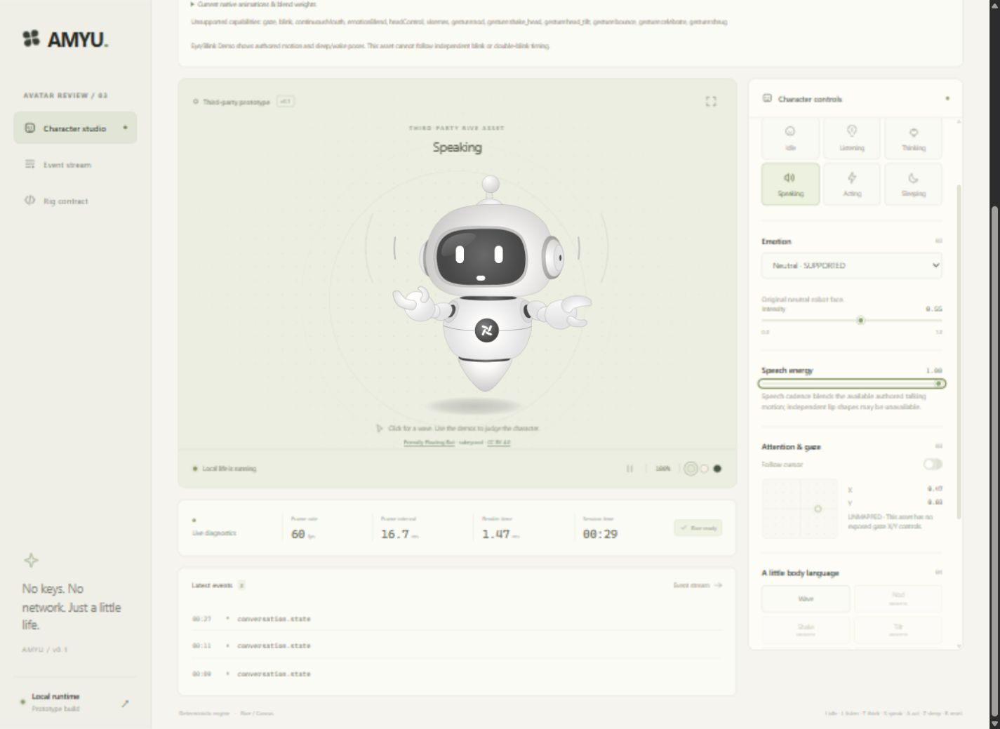
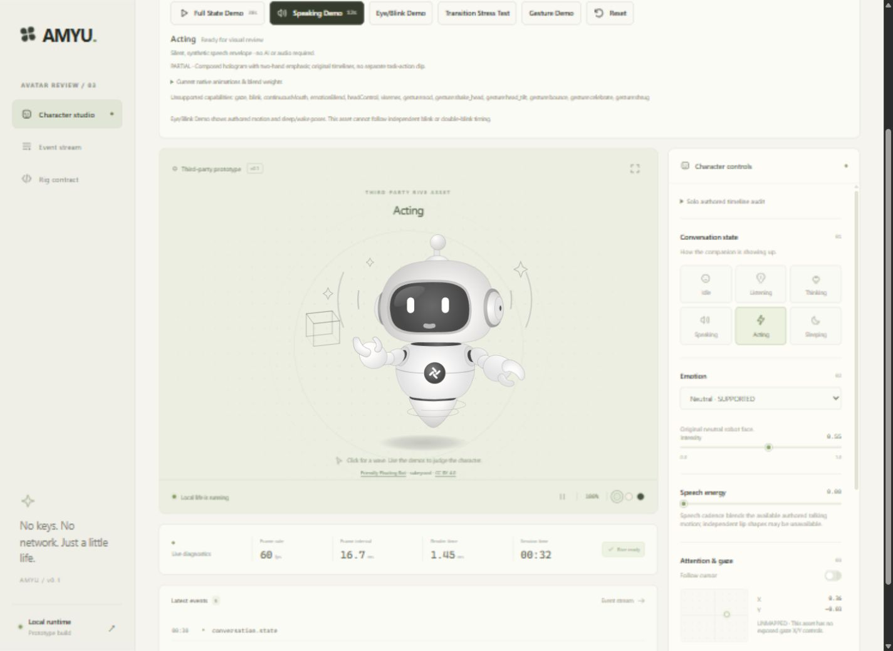
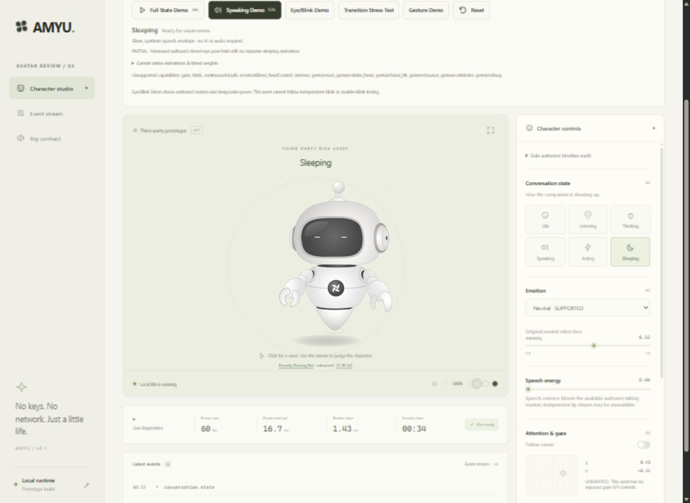

# Avatar deep refinement — robot product review

Updated **2026-10-09**. **Friendly Floating Bot is now the active review prototype. The full visual-quality brief is not met, and no avatar has human visual approval.** The user rejected Candidate C and requested an existing soft character closer to A, preferably a robot. D follows that direction. All six states have real authored compositions; their semantic readability is still partial.

## A. Which avatar is active

**Candidate D — Friendly Floating Bot, by sukeycool** is the default in the lab and Rive renderer. [Official source](https://www.rive.app/marketplace/28071-53022-friendly-floating-bot/), **CC BY 4.0**. The original download is unchanged: **139,255 bytes**, SHA-256 `03cf8342c66171d7d5b09a00f363118d16528d372080cbb2d4b21f7d5147dc54`.

It is a compact white/gray floating robot with a dark visor, two white eyes, small articulated hands, antenna and original chest logo. The light appearance is authored in the file. Uniform framing removes the original demonstration button row while retaining the sampled robot, shadow and active props; no artwork was drawn, generated or edited. A remains a reference and C is explicitly labeled rejected in the development picker. The old generated character remains a test fixture.

## B. What changed visually

The active robot replaces the mint reference character. AMYU composes the original Idle, Welcome, Receive and Talking material into the six states. Listening raises one greeting hand; thinking introduces a one-hand cube/hologram; speaking changes the visor speech mark and raises both hands with the speech envelope; acting combines the hologram and two-hand emphasis; sleeping holds an actual closed-eye frame.

The adapter shares an authored phase across its body clips, so changing speech energy does not restart their clock. Actual WASM history tests found retained overlay properties before a reset fix. Welcome, Receive and Talking now restore their authored starting properties before Idle and current overlays are reapplied. This clears old hands, props, mouth and draw-order effects instead of relying on a zero mix to undo them. Reset reconstructs playback from the already loaded original asset.

Reduced motion holds the main body phase at 0.5 and reduces speech gain to 30%. It preserves the closed sleep pose. Nested authored props have their own clocks; this is reduced main-body motion, not a promise that every internal effect stops.

## C. How Idle looks

**PARTIAL.** The robot floats gently with relaxed low hands and upright visor eyes. Its simple silhouette fits the requested soft robot direction. Authored blinks interrupt the fixed gaze, but there is no pupil control, independently timed blink or breathing/posture channel. A sustained browser Idle run lasted **3m02s**, with the visible session clock advancing from **46:08 to 49:10**. Separate frames and a short sequence were observed during that run; this was not a continuous video inspection. The approximately six-second float remained conspicuously repetitive, but the final pose stayed clean. The longer total session clock is not claimed as a continuously observed soak.

## D. How Listening looks

**PARTIAL.** One greeting hand moves between an outward palm and a position beside the face, with a small smile. It is visibly different from low-handed idle, but can still read as a wave or greeting. There is no dedicated listening lean, head aim or attentive pupil movement. Ten successful toggles establish transition reliability; they cannot establish that a human interprets the pose as listening without its label.

## E. How Thinking looks

**PARTIAL.** The robot presents the original rotating wireframe cube and small sparkles above one hand. This gives a visible processing cue. The head and eyes are the same authored shapes as Idle at a shared phase, so this is outward computation rather than a convincing inward thinking expression. Thinking and acting share the same prop, which weakens their distinction.

## F. How Speaking looks

**PARTIAL.** Both arms communicate and small curved speech lines appear beside the robot. The white visor mark changes through the authored timeline, and its mix follows the irregular synthetic syllables. Speech is more visible in the whole-body pose than in the tiny mouth mark. Face and arms use the same gain, so syllable bursts can make the arms pop or flap. This remains below the requested natural, expressive conversation quality.

## G. Exactly how the mouth is animated

There is **no independent numeric mouth aperture or viseme control**. The original Talking loop supplies the white speech trace, side marks and arm/body motion as one coupled clip. At integer authored frames, the visor trace measures approximately **3.39–11.26 artboard units wide** and **0.11–1.33 high**. Its appearance ranges from a tiny dot/capsule to a narrow line or smile-like mark; it is not a broad range of phoneme shapes.

The phase is elapsed time × **0.2** over the **29/24-second authored work range**. It continues when gain is zero. In an awake speaking state, Talking mix is speaking weight × clamped speech energy; reduced motion multiplies that gain by 0.3. The **12-second** demo supplies **28 irregular syllable pulses**, weak/strong emphasis, micro pauses and phrase pauses. At zero gain, Talking disappears and the reset/Idle baseline restores rest. Acting separately uses Talking at **0.58 × acting weight**, so that state can retain a speech-like trace. This coupling is an asset limitation.

## H. What changed about the eyes

D uses its original white robot visor eyes and embedded blink tracks. All five changing body clips contain matching blinks; the shared phase avoids mixing different blink phases. At authored frame 3, both eye pills collapse from about 15.85 to about 0.95 artboard units high. Idle progress **1/14** selects this measured closed pose for sleep. The settled browser sleep pose has fine, fully closed white lines and a still body.

AMYU's independent blink/openness fields do **not** drive D's lids. The QA panel reports that limitation; the Eye/Blink Demo cannot prove forced or varied LocalLifeEngine blinking on this asset. The original blink timing remains repetitive, and there is no pupil tracking, state-specific lid shape or independently controlled double blink. A's earlier dedicated eight-timeline eye refinement remains documented in the [historical A/C review](avatar-deep-review-candidate-a.md) and [A animation audit](avatar-animation-audit.md); it must not be attributed to D.

## I. Which states remain weak

All six are rated **PARTIAL**. Idle repeats; listening is an ambiguous greeting; thinking lacks inward attention; speaking has a very small mouth and coupled arm pulses; acting resembles thinking with both hands raised and a partly faded hologram; sleeping freezes the entire body rather than breathing. The six drawings are technically distinct, but the required label-free meaning is not established. A clean transition does not remove these artistic limits.

## J. Which emotions are genuinely represented

| Emotion | Classification | Actual representation |
| --- | --- | --- |
| Neutral | SUPPORTED | Original neutral robot face and idle baseline |
| Happy | UNSUPPORTED | Greeting/speech smile is not an independent happy expression |
| Excited | UNSUPPORTED | No distinct excited face or mapped emotion clip |
| Curious | UNSUPPORTED | No independent curious head/eye expression |
| Concerned | UNSUPPORTED | No verified concern or frown control |
| Surprised | UNSUPPORTED | No verified surprise expression |
| Empathetic | UNSUPPORTED | No distinct empathy expression |
| Amused | UNSUPPORTED | No independently controlled amused face |
| Focused | UNSUPPORTED | Hologram state is not an emotion mapping |
| Confused | UNSUPPORTED | No verified confused expression |

Selecting a semantic emotion does not manufacture a distinct expression. Non-neutral emotions remain explicitly unsupported in this adapter.

## K. Which gestures and interactions work

**Wave is the only mapped gesture.** Its envelope is sin(π × progress) × intensity. Welcome is applied last and Receive/Talking gains are attenuated by one minus that envelope, so thinking or speaking cannot mask the greeting. Listening already uses Welcome at 0.9, so the additional Wave cue there is small. Nod, shake-head, head-tilt, bounce, celebrate and shrug remain unsupported. The original float is not a discrete bounce, and the two talking arms are not a shrug.

Click requests a supported Wave and repeated requests coalesce. Click-to-wake changes the awake/state semantics. Hover has no independently mapped visible attention reaction; cursor telemetry is not pupil or head tracking. Completed browser interaction observations are recorded below rather than inferred from these controls.

## L. Did Candidate A reach its ceiling?

**YES. Can A meet the required quality with its measured controls? NO.** After a complete eighteen-timeline audit and one focused refinement pass, listening still failed, speech/mouth remained weak, and facial expression plus attention/gaze were insufficient. That exceeds the brief's two-area stop rule. Beauty refinement on A stopped. Its audit, actual 3m25s idle observation, demos and limitations remain in the [historical product review](avatar-deep-review-candidate-a.md).

## M. Was Candidate C actually evaluated?

**YES, and the user rejected its model.** The original [Interactive Character Rig — Bones, Joysticks and Data Binding](https://rive.app/marketplace/28370-53642-interactive-character-rig-bones-joysticks-and-data-binding/) by aln.omrv was downloaded and inspected. Its actual look is a bright carrot head with green leaves, glossy eyes and a white background. Binding its sole exported ViewModel trigger produces a real authored head/pupil/brow reaction and return.

The export has zero state-machine inputs and one trigger property, not the hoped-for exposed numeric eye/head controls. No verified speech mouth route was found. Headless mesh limitations prevent a stronger claim about every possible internal handle; further beauty/handle evaluation stopped after the user rejected the look. See [C evidence](interactive-character-capabilities.md) and the historical comparison.

## N. Candidate comparison and active selection

**D is now active for robot review; C is not selected.** This follows the user's appearance preference and request to proceed. It does not record their approval of D's final quality.

| Criterion | A — soft floating figure | C — rejected carrot | D — active robot review |
| --- | --- | --- | --- |
| Visual appeal | Soft mint reference; user found it inadequate | User explicitly rejected model | Soft white/gray robot fits requested direction; approval open |
| Eyes | Refined soft lids, fixed pupils | Large glossy eyes, authored directional reaction | Original white visor eyes, fixed pupils |
| Blink | Independently driven authored lids verified | Independent phase route unverified | Embedded blink only |
| Listening | Failed: too similar to idle | No verified distinct pose | Raised greeting hand, semantic ambiguity |
| Thinking | Recognizable hand-to-chin | No verified thought pose | One-hand hologram; no inward gaze |
| Speaking | Small mouth and restrained body | No verified speech route | Tiny speech mark, side lines, both arms |
| Mouth | Closed/slit/triangle authored cycle | Happy open mouth without verified speech driver | Tiny coupled trace, no aperture/visemes |
| Gaze | Unsupported | Authored directional reaction, independent axes unverified | Unsupported |
| Head movement | Authored poses, no head follow | Authored head-turn reaction | Embedded float, no independent head control |
| Facial expression | Neutral and partial smile | Happy baseline and authored brow tilt | Neutral; state-coupled smile only |
| Gestures | Wave | Generic native activation | Greeting/Wave only |
| Idle life | Repetitive 5s float; locally varied blink | Short authored idle; review stopped on rejection | Repetitive approximately 6s main phase; embedded blinks |
| Runtime control | 18 timelines, two diagnostic booleans | 12 timelines, one bound VM trigger | 10 main timelines, four native inputs, theme VM |
| Integration | Authored composition and rest resets | Native ViewModel trigger and pointer route | Authored composition, presentation crop and rest resets |
| License | CC BY 4.0, original retained | CC BY 4.0, original retained | CC BY 4.0, original retained |
| Long-term usefulness | Practical face/attention ceiling reached | Rejected appearance, speech gap | Better style match, substantial conversation-control gaps |

## O. Actual review evidence and acceptance matrix

Environment: **Windows, Codex in-app browser, localhost:5173, Rive Canvas 2.44.0**. Evidence uses the actual rendered canvas. Stills establish appearance at sampled moments; they do not establish full motion quality. No screen recording was made; the development demos are repeatable.

| Review | D execution and observation |
| --- | --- |
| Original asset audit | Actual main artboard, ten main timelines, four native inputs and theme ViewModel inspected; authored phase/drawing probes recorded |
| Six state samples | All six captured after the overlay-reset fix; settled sleep also inspected after 2.2s |
| Full State Demo | **38s completed**; listening, thinking, speech, sleep, wake and final idle sampled; acting also reviewed directly |
| Speaking Demo | **12s completed**, with speech/pause samples and final clean Idle. Manual energy 0, 0.3, 0.7 and 1 also reviewed: trace/arms change together, zero restores rest |
| Eye/Blink Demo | **20s completed**; original eyes, closed sleeping lines and wake sampled. Forced independent D lid control remains unsupported |
| Transition Stress | **113s completed after the Wave/wake fixes**. The earlier 103s run supplied nine initial edge samples; the final run included all repetitions, with rapid L/T/S and speech/thought returns sampled and a clean final Idle. No retained hands, mouth, props or draw-order faults observed in those samples |
| Gesture Demo | **20.4s completed after the Wave-order fix**; idle/listening sampled in the sequence, direct thinking/speaking Wave captures verify greeting priority, final idle clean. Additional Wave is weak during listening because that state already uses Welcome |
| Actual idle observation | **3m02s**, visible session clock **46:08 → 49:10** after reset, with no state changes during the interval. Sampled motion repeats its approximately six-second float; fixed eyes limit attention. Final hands/face/body clean |
| Hover/click/reset | Single click visibly greets; ten repeated clicks settle to clean Idle without a long queue; sleeping click wakes to Idle. Reset restores neutral playback. Pause/resume exercised. Pointer movement does not create directed eyes/head; hover remains unsupported |
| Reduced motion | Main Idle pose held across separated samples; speech arms/trace attenuated. Nested prop effects can still move |
| Remaining original timelines | Theme_Dark, Theme Light, typex logo ai, tracking off and tracking on individually previewed at 50%, completing browser samples of all ten main timelines alongside the earlier five body clips |
| Emotions | All ten selections exercised at default intensity. Only neutral is represented independently; nine non-neutral choices remain explicitly unsupported |

### Actual state captures

The following are D's actual browser frames after the reset fix on 2026-10-09.

| Idle | Listening |
| --- | --- |
|  |  |

| Thinking | Speaking |
| --- | --- |
|  |  |

| Acting | Sleeping |
| --- | --- |
|  |  |

Additional interaction evidence: [Wave from thinking](screenshots/avatar-deep-refinement/d-wave-from-thinking.jpg), [Wave from speaking](screenshots/avatar-deep-refinement/d-wave-from-speaking.jpg). A/C captures and completed historical runs remain in the [prior review](avatar-deep-review-candidate-a.md). They are not D validation.

Additional actual frames: [speech cadence](screenshots/avatar-deep-refinement/d-speech-cadence.jpg), [completed stress run](screenshots/avatar-deep-refinement/d-stress-final.jpg), [repeated-click return](screenshots/avatar-deep-refinement/d-click-return.jpg), [idle start](screenshots/avatar-deep-refinement/d-long-idle-start.jpg) and [idle end](screenshots/avatar-deep-refinement/d-long-idle-end.jpg).

The resumed browser initially contained failed WASM fetch/HMR messages while its local server was stopped. Restarting the existing Vite server and reloading restored the robot. A later browser log read contained those earlier startup errors and no new warning/error entries from the completed review runs. The temporary desktop viewport override was reset; the normal narrower app-browser layout also retained the complete robot and review controls.

### 21-feature visual acceptance matrix

PASS means the recorded criterion passed, PARTIAL means a real mapping has a material quality limitation, FAIL means the observed criterion was missed, and UNSUPPORTED means there is no defensible visible mapping. None means human approval.

| Feature | Result | Visual quality | Native/Composed | Limitation |
| --- | --- | --- | --- | --- |
| Idle | PARTIAL | Soft float and relaxed hands | Original Idle with shared phase | Repetitive float/blinks; no independent breathing |
| Eyes | PARTIAL | Simple readable white visor eyes | Original body clips | Fixed gaze; no state-specific lid shaping |
| Blink | PARTIAL | Original eyes close to fine lines | Embedded authored tracks | Independent/local timing unsupported |
| Listening | PARTIAL | Raised greeting hand, small smile | Welcome ×0.9 | Can read as greeting or wave |
| Thinking | PARTIAL | One hand with cube/hologram | Receive loop | No inward gaze/head cue |
| Speaking | PARTIAL | Both arms and side speech lines move | Talking × syllable gain | Arms and face coupled; bursts can look abrupt |
| Mouth | PARTIAL | Tiny white dot/capsule/line variation | Original Talking trace | Small, no numeric aperture or visemes |
| Acting | PARTIAL | Hologram and two raised hands | Receive + Talking ×0.58 | Similar to thinking; prop fades and speech trace remains |
| Sleeping | PARTIAL | Fully closed fine lines, still body | Held Idle progress 1/14 | Full-body freeze, no sleep breathing |
| Wake | PARTIAL | Returns to running Idle phase | Awake/state interpolation | No dedicated wake clip; coupled phase transition |
| Hover | UNSUPPORTED | No mapped visible attention reaction | Unmapped semantic hover | No independent smile, pupil or head route |
| Click | PARTIAL | Greeting/Wave request and wake semantics | Authored Welcome composition | Bounded/coalesced; shared pose limits reaction quality |
| Wave | PARTIAL | Original hand greeting | Authored Welcome × gesture envelope | Shares listening material; no separate wave track |
| Other gestures | UNSUPPORTED | Six missing behaviors remain explicit | No mapping | Nod, shake, tilt, bounce, celebrate and shrug absent |
| Happy | UNSUPPORTED | No independently driven happy face | State smile only | Shared smile is not a distinct emotion mapping |
| Curious | UNSUPPORTED | No distinct expression | No mapping | Missing face/head/gaze channels |
| Concerned | UNSUPPORTED | No distinct expression | No mapping | Missing frown/brow controls |
| Surprised | UNSUPPORTED | No distinct expression | No mapping | Missing surprise controls |
| Gaze | UNSUPPORTED | No pupil following | Telemetry only | No visible control verified |
| Head follow | UNSUPPORTED | No head following | Telemetry only | No independent head control verified |
| Return-to-idle | PASS | Clean final rest after full states, speech, gesture and 113s stress | Overlay reset + Idle baseline | Covers sampled transitions/final frames and actual WASM history checks; not human approval or continuous video review |

## P. Automated validation

**The final post-fix pnpm check passed:** ESLint, TypeScript, **112 tests across 16 files**, and production builds for both browser lab and desktop frontend. The eight real-WASM D tests cover original metadata, six distinct drawings, zero-energy rest, gain variation, interrupted/repeated history, closed sleep, wake, reduced motion, Wave precedence and bounded malformed inputs. The seventeen session tests include demo interruption/consistency. Other tests cover playback reset, ViewModel ownership, persistent authored clocks, cadence/cancellation and supported-only gestures.

Geometry tests validate actual drawing output and catch retained properties; they cannot score warmth, natural speech or semantic recognition. Frontend builds do not compile Rust. Historical Windows Application Control error **4551** remains the native executable blocker; native work is outside this milestone. See [the build report](build-report.md).

## Q. Recommendation and stop point

**SWITCH AVATAR — to D as the active robot review prototype.** That switch is implemented. It is a better match for the user's preferred direction than rejected C, while A has reached its ceiling. D still lacks the independent face, mouth, gaze and state-specific motion needed to satisfy the full brief. Further application mixing cannot create those missing authored controls.

The next decision belongs to the user: judge this robot's appearance and whether its documented compromises are acceptable before further art selection or a purpose-authored rig. **This is not a declaration that the avatar milestone is complete.** Onboarding, voice/providers, memory, vision, skills, shell/tray and connectors remain paused until explicit visual approval. No later product stage is started by this report.

